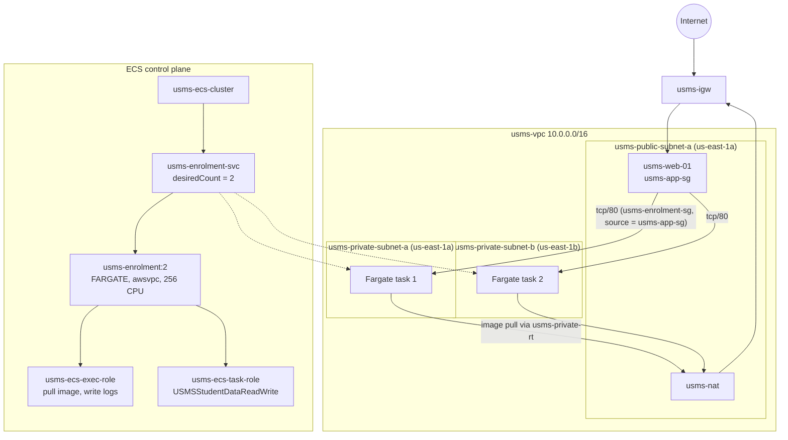

# AWS Practical Laboratory Report

**Name:** Namgyel Wangchuk
**Student No.:** 02230291
**Module:** DSO303
**Practical:** Lab 04 – Amazon ECS (Deploying the USMS Enrolment Service on Fargate)
**Date:** 11 October 2026

**Tools used:** Floci (local AWS emulator) running under Docker Compose in hybrid storage mode, AWS CLI v1, jq, python3, git, nano

---

## 1. Aim / Objective

The aim of this practical is to move the USMS enrolment service onto Amazon ECS using the Fargate launch type. This means creating an ECS cluster, a task definition with two separate IAM roles, a log group, a security group that only allows the web tier in, and a service that keeps two tasks running across both private subnets from Lab 2. The goal is to get the service built correctly and standing still at a fixed size, so that Lab 05 can put a load balancer in front of it and Lab 06 can add auto scaling.

## 2. Introduction

Amazon Elastic Container Service (ECS) is AWS's service for running Docker containers. Instead of looking after a server like in Lab 3, you describe what container you want, how much CPU and memory it needs and which roles it uses, and ECS runs it for you. With the Fargate launch type there are no EC2 servers to manage at all; AWS finds somewhere to run each task and you pay per task per second. ECS matters in cloud computing because it lets an application restart failed copies automatically and change how many copies are running without anyone logging into a machine. It is commonly used for web APIs, background workers and microservices.

### Key Features

- **Cluster:** a logical group for services and tasks (on Fargate it has no servers of its own)
- **Task definition:** a versioned, read-only blueprint of the container (image, CPU, memory, ports, roles, logs)
- **Task:** one running copy of a task definition
- **Service:** keeps the number of running tasks equal to the desired count and replaces tasks that stop
- **Fargate:** serverless launch type, no instances to patch or scale
- **awsvpc networking:** every task gets its own network interface, private IP and security group
- **Two IAM roles per task:** an execution role (for ECS itself) and a task role (for the app code)
- **CloudWatch Logs integration** through the `awslogs` log driver

## 3. Use Case

In USMS, the enrolment service is what the student portal calls when a student clicks "Register for this module". Most of the week it gets very little traffic, but on the Monday of enrolment week around 4,000 students try to register in the first twenty minutes. A single fixed EC2 server can't handle that, and if it crashes someone has to notice and fix it by hand.

Running the enrolment service on ECS fixes the first part of this problem:

| Need | How ECS handles it |
|---|---|
| A failed copy should come back on its own | The service sees runningCount drop and starts a new task |
| Survive one Availability Zone failing | The service spreads tasks over two private subnets in two AZs |
| Only the web portal should call it | The task security group only allows traffic from `usms-app-sg` |
| No passwords or keys in the container | The task role gives the app temporary credentials |
| Change capacity without touching servers | Change one number, `desiredCount` (done by Lab 06 automatically) |

## 4. System Architecture / Design

The enrolment service runs as two Fargate tasks, one in each private subnet. The only allowed caller is the web tier (`usms-app-sg`). The tasks have no public IP, so they reach the container registry through the NAT gateway from Lab 2.

*Lab 04 architecture: ECS service in the private subnets, called only by the web tier*

## 5. Implementation Procedure

I started Floci, loaded the env files from Labs 1 to 3 and ran the Lab 2 and Lab 3 verify scripts to make sure nothing had changed since last week. I then probed the Floci build and found it supports ECS and CloudWatch but not Application Auto Scaling (support path B). I assumed `usms-developer-role` and created the ECS cluster as that role, then went back to my normal identity. Next I created the `/usms/ecs/enrolment` log group with 7-day retention, the task execution role with my own least-privilege policy, and the task role, which reuses Lab 1's `USMSStudentDataReadWrite` policy unchanged. I created `usms-enrolment-sg` with an inbound rule that points at `usms-app-sg` instead of an IP range, wrote the task definition as a JSON template and registered it as `usms-enrolment:1`. Then I created `usms-enrolment-svc` with a desired count of 2 across both private subnets with no public IP, read back its four health numbers, and changed the desired count to 3 and back to 2 by hand. Finally I recorded everything into `configs/lab-04.env`, wrote the verify and cleanup scripts, and committed the work. After that I did the five independent exercises (written up in `exercises.md`).

## 6. Results and Evidence

### 6.1 CLI Output

**Screenshot 1**

Resume the environment and load the env files

/step1.png)

*All 8 values from Labs 2 and 3 loaded, and whoami confirms account 000000000000 (Floci, not real AWS)*

---

**Screenshot 2**

Lab 02 verification

/step2(1).png)

*verify-lab-02.sh gives PASS=32 FAIL=1. The one failure is the known Floci group-reference limitation from Lab 2*

---

**Screenshot 3**

Lab 03 verification

/step2(2).png)

*verify-lab-03.sh gives PASS=33 FAIL=3, the same three documented Floci limitations as in Lab 3. The two checks Lab 4 depends on (private route table has no IGW route, usms-web-01 carries usms-app-sg) both pass*

---

**Screenshot 4**

Probe what this Floci build supports

/step3.png)

*ECS, CloudWatch and CloudWatch Logs are supported. Application Auto Scaling is not, so this build is on support path B*

---

**Screenshot 5**

Assume the developer role

/step4.1.png)

*get-caller-identity shows an assumed-role ARN for usms-developer-role*

---

**Screenshot 6**

Create the ECS cluster and return to normal identity

/step4.2.png)

*usms-ecs-cluster is ACTIVE with 0 services and 0 tasks, identity is back to root. Settings comes back as null*

---

**Screenshot 7**

Create the log group

/step5.png)

*/usms/ecs/enrolment created with a 7-day retention policy*

---

**Screenshot 8**

Task execution role

/step6.png)

*usms-ecs-exec-role trusts ecs-tasks.amazonaws.com and carries USMSECSTaskExecution*

---

**Screenshot 9**

Task role reusing the Lab 1 policy

/step7.png)

*usms-ecs-task-role has USMSStudentDataReadWrite attached, the same policy document Lab 3 Step 11 printed for the EC2 role*

---

**Screenshot 10**

Enrolment security group

/step8.png)

*The ingress call returned a rule ID, but the readback shows port 80 with FromGroup null (Floci limitation)*

---

**Screenshot 11**

Register the task definition

/step9.png)

*usms-enrolment:1 is ACTIVE, awsvpc, FARGATE, 256 CPU / 512 MiB, with two different role ARNs for exec and task*

---

**Screenshot 12**

Checking the log configuration

/step9-logconfig.png)

*The local template has the awslogs block, but Floci returns null for logConfiguration*

---

**Screenshot 13**

Create the service

/step10.png)

*The service was created. The waiter crashed on a null field, so I polled by hand: running went from 0 to 2 within about 5 seconds*

---

**Screenshot 14**

Read the service back (the four numbers)

/step11.png)

*ACTIVE, desired 2, running 2, pending 0, both private subnets, assignPublicIp DISABLED, list-tasks returns 2*

---

**Screenshot 15**

Your turn: change the desired count by hand

/step11(myturn).png)

*Desired 3 with running still 2, then back to desired 2 and running 2*

---

**Screenshot 16**

Write configs/lab-04.env

/step12.png)

*All values populated, 17 exports, baseline desired count 2*

---

**Screenshot 17**

Run the verify script

/step13-verify.png)

*verify-lab-04.sh gives PASS=37 FAIL=1. The only failure is the group-referenced security group rule*

---

**Screenshot 18**

Cleanup script syntax check

/step13-cleanup.png)

*lab-04-cleanup.sh passes bash -n and was not run*

---

**Screenshot 19**

Commit

/step13-commit.png)

*Lab 04 committed as 5ee99e6, after checking nothing under outputs/ was staged*

---

The screenshots for the five independent exercises are in [`exercises.md`](exercises.md).

### 6.2 AWS Console Verification

Floci is a local emulator and does not have an AWS Management Console, so console screenshots were not possible for this lab. Instead, every resource was checked by reading it back with `describe-*` and `list-*` commands (Screenshots 6 to 16) and by `verify-lab-04.sh` (Screenshot 17), which runs 38 checks in one go. On real AWS the same things would be checked in the ECS console under Clusters → usms-ecs-cluster → Services and Task definitions, in the IAM console under Roles, in the VPC console under Security groups, and in CloudWatch under Log groups.

## 7. Analysis and Discussion

Most of the lab worked as expected. The cluster, log group, both IAM roles, the security group, the task definition and the service were all created, and the verify script passed 37 out of 38 checks. The service ended in the right state: two tasks, two private subnets, no public IP, and two different roles for the execution role and the task role. The task role uses the same `USMSStudentDataReadWrite` policy as the EC2 instance from Lab 3, so two completely different kinds of compute now hold the same permission without either having an access key.

The results did not match the lab's expected output in a few places. All of them came from Floci, not from my commands:

| What happened | What real AWS would do |
|---|---|
| The group-referenced inbound rule on `usms-enrolment-sg` returned a rule ID but read back with `FromGroup: null`. This is the same problem as Lab 2 Ex 2 and Lab 3 Step 17, and it is the one verify failure | Store the rule and only allow port 80 from instances carrying `usms-app-sg` |
| `logConfiguration` read back as `null`, even though the template file contains it | Send the container's stdout to `/usms/ecs/enrolment` |
| `aws ecs wait services-stable` crashed with `In function length(), invalid type for value: None`, because Floci returns `null` for the service's deployments | Wait about 40 seconds until both tasks are running |
| Tasks went from 0 to 2 in about 5 seconds | Fargate tasks take 20 to 60 seconds to start |
| The service's `events` list was `None` | Show messages like "has reached a steady state" |
| `taskDefinition` on the service showed `usms-enrolment` instead of the full ARN with `:1` | Return the full ARN with the revision number |
| Cluster `Settings` came back `null`, so Container Insights was not recorded | Show `containerInsights = enabled` and publish CPU metrics (Lab 06 needs these) |
| The assumed role session showed as `floci-session` instead of `lab04-ecs-build` | Use the session name I passed |
| Application Auto Scaling returned `UnknownOperationException` | Fully supported (affects Lab 06, not this lab) |

One finding was about IAM rather than Floci's data. My `USMSDeveloperBase` v3 policy has no `ecs:` actions at all, but creating the cluster as the developer role still worked. On real AWS this would have been denied with AccessDenied, and I would have needed to add `ecs:CreateCluster` and `ecs:TagResource` in a new policy version, like I did for the Lab 2 actions in Lab 1 Exercise 5. This matches the Lab 1 Step 32 finding that Floci does not fully check IAM permissions.

There were also a few problems on my side that I fixed:
- My `lab-01.env` stores `USMS_ROLE_DEVELOPER` and `USMS_POLICY_S3_RW` as full ARNs. The lab's commands wrap them in `arn:aws:iam::...:role/` again, which would have made a broken ARN, so I used the variables directly.
- My machine has AWS CLI v1, which doesn't have the `--no-cli-pager` option. I removed it from that command.
- The verify script counted the tracked `outputs/.gitkeep` as a leaked secret. I changed that check to skip `.gitkeep`, the same fix I made in `verify-lab-02.sh`.

Following the lab's Section 12.1, these are the things I actually **observed**: the cluster, task definition revisions, the service in two private subnets, two roles with the same trust policy, the same Lab 1 policy on a second kind of compute, desiredCount changing by hand, and the tags on the cluster and service. Things I only **reasoned about**: the security group actually blocking traffic, logs reaching CloudWatch, Container Insights metrics, real task start times and the cost.

## 8. Reflection

**What I learned.** The most useful thing was finally understanding the difference between the four ECS objects. Before this lab I thought of a task definition and a service as roughly the same thing. Now I understand the task definition is just a blueprint that can't be edited, and the service is what actually keeps things running. When I set the desired count to 3 and saw "Desired 3, Running 2", it made it clear that desiredCount is only a target and the service has to catch up to it. I also learned the difference between the execution role and the task role: if the task won't start, it's the execution role, and if it starts but the app gets AccessDenied, it's the task role.

**Challenges.** A lot of my time went into working out whether a strange result was my mistake or Floci's. The waiter error looked like I had typed something wrong, and the `null` log configuration made me think my heredoc had failed, until I compared the file with what Floci returned. The ARN problem with my env file would have been hard to spot if I hadn't checked the variables first. I also registered the second task definition twice by accident, which taught me that revisions can only be made inactive, not deleted.

**Real-world use.** I would use ECS on Fargate for any service where traffic goes up and down a lot, like enrolment or exam result day at the college. The service would replace a crashed copy on its own, the two-AZ setup would keep it running if one zone had problems, and the task role means no access keys ever go inside the container image. The security group that points at another group, instead of an IP range, is the right way to lock it down because task IPs keep changing.

**What I want to explore next.** I want to see Lab 05 and 06 put a load balancer and auto scaling on this same service. Since my Floci build doesn't support Application Auto Scaling, I would like to try it on a real AWS account to see a policy actually change the desired count. I'm also interested in rolling deployments (how ECS swaps old tasks for new ones without downtime), Fargate Spot for cheaper tasks, and building my own container image and pushing it to ECR instead of using the nginx placeholder.

## 9. Conclusion

The objectives of this practical were achieved. The USMS enrolment service is running on ECS Fargate as `usms-enrolment-svc`, with two tasks spread over both private subnets, no public IP, separate execution and task roles, and a security group meant to allow only the web tier. The verify script passed 37 of 38 checks, and the single failure, along with the other differences I found, comes from Floci limitations that are documented above with what real AWS would do instead.

This lab connected all three earlier labs. It used the IAM policy from Lab 1, the private subnets and NAT gateway from Lab 2, and the web tier security group from Lab 3. It showed that the same IAM policy can be given to an EC2 instance and a container in two different ways without any keys. The main skills I practised were writing and registering task definitions, creating services with awsvpc networking, reading a service's health from its four numbers, and checking API responses against what was actually stored instead of trusting a success message. This sets things up for Lab 05 and Lab 06, which only need to add a load balancer and let `desiredCount` change on its own.

## 10. Appendix

### Additional Files

- `configs/lab-04.env`
- `policies/trust-ecs-tasks.json`
- `policies/usms-ecs-task-execution-policy.json`
- `policies/usms-enrolment-sg-ingress.json`
- `templates/lab-04-taskdef.json`
- `templates/lab-04-taskdef-v1.json`
- `templates/lab-04-taskdef-v2.json`
- `scripts/utilities/verify-lab-04.sh`
- `scripts/utilities/lab-04-ecs-inventory.sh`
- `scripts/cleanup/lab-04-cleanup.sh` (written, not run)
- `labs/lab-04-ecs/exercises.md`
- `labs/lab-04-ecs/lab-04-lab03-linkage.txt`
- `notes/lab-04-notes.md`

### Submission Checklist

- [x] Student information completed
- [x] Objectives stated
- [x] Introduction provided
- [x] Real-world use case described
- [x] Tools listed
- [x] System design included
- [x] Implementation documented
- [x] CLI outputs included
- [x] Console verification addressed (Floci has no console, see 6.2)
- [x] Analysis completed
- [x] Reflection completed
- [x] Conclusion written