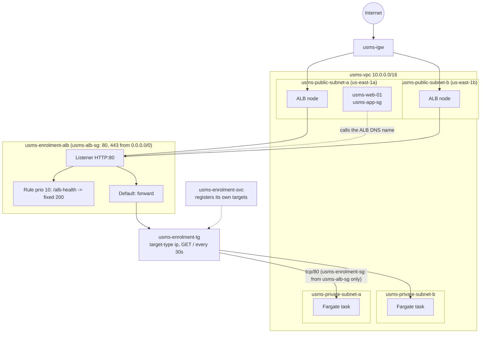

# AWS Practical Laboratory Report

**Name:** Namgyel Wangchuk
**Student No.:** 02230291
**Module:** DSO303
**Practical:** Lab 05 – Putting the ECS Service Behind an Application Load Balancer
**Date:** 11 October 2026

**Tools used:** Floci (local AWS emulator) running under Docker Compose in hybrid storage mode, AWS CLI v1, jq, python3, curl, git, nano

---

## 1. Aim / Objective

The aim of this practical is to give the USMS enrolment service from Lab 04 a stable front door. In Lab 04 the service ran two Fargate tasks in private subnets, but their IP addresses changed every time a task was replaced, so nothing could point at them. In this lab I put an internet-facing Application Load Balancer (ALB) in front of the service, with a target group that the ECS service fills by itself, a listener and a listener rule, and then did a security cutover so that the load balancer became the only thing allowed to reach the tasks.

## 2. Introduction

Elastic Load Balancing is the AWS service that spreads incoming traffic across a group of targets and only sends requests to targets that pass a health check. An Application Load Balancer works at layer 7, so it can read the HTTP request and route it based on the path, host or headers. Its main job in this lab is to give a stable DNS name in front of tasks whose addresses keep changing. Load balancers are one of the most common pieces of AWS architecture, because almost every web app that runs more than one copy of itself needs one, and they are what makes zero-downtime deployments and auto scaling possible.

### Key Features

- **Load balancer:** has the DNS name, sits in two or more Availability Zones and has its own security group
- **Listener:** one port and protocol (here HTTP:80) with exactly one default action
- **Rules:** a condition plus an action, checked in priority order before the default action
- **Target group:** a list of targets plus the health check that decides which ones get traffic
- **Target type `ip`:** required for Fargate tasks, which have no instance ID
- **Health checks:** the load balancer probes each target and stops sending traffic to failing ones
- **Deregistration delay (connection draining):** lets in-flight requests finish before a task is removed
- **ECS integration:** the ECS service registers and deregisters its own tasks in the target group

## 3. Use Case

The USMS student portal (`usms-web-01`) needs to call the enrolment API. After Lab 04 there was no fixed address it could use, because each Fargate task gets a new private IP when it starts. Writing task IPs into the portal's config would break every time a task was replaced, scaled or redeployed.

| Problem | How the ALB solves it |
|---|---|
| Task IPs change all the time | The portal calls one stable DNS name; the target group keeps the IP list up to date |
| Someone has to update the IP list | The ECS service registers new tasks and removes old ones automatically |
| A broken task keeps getting requests | The health check takes it out after 2 failed checks (about 60 seconds) |
| Requests get cut off during a deployment | Deregistration delay gives in-flight requests 30 seconds to finish |
| Tasks should not be reachable directly | After the cutover, the task security group only allows the ALB's group |
| Later, results and transcripts need their own paths | Listener rules can route `/results` or `/transcripts` to other target groups |

## 4. System Architecture / Design

The ALB has one node in each public subnet. The listener on port 80 has a rule at priority 10 for `/alb-health` and a default action that forwards to `usms-enrolment-tg`. The ECS service registers its two tasks (in the private subnets) into that target group. After the cutover, `usms-enrolment-sg` only allows port 80 from `usms-alb-sg`.

*Lab 05 architecture: an internet-facing ALB in the public subnets in front of the private Fargate tasks*

*Image Source: N/A*

## 5. Implementation Procedure

I started Floci, loaded the five env files and re-ran the Lab 2, 3 and 4 verify scripts to make sure nothing had changed. A probe showed that this Floci build supports ELBv2. I created `usms-alb-sg` allowing port 80 (and later 443) from the internet, then the internet-facing ALB in both public subnets. Next I created `usms-enrolment-tg` with target type `ip` and a health check on `/`, set the deregistration delay to 30 seconds and the algorithm to least outstanding requests, and created the HTTP:80 listener forwarding to it. I added a rule on `usms-enrolment-sg` allowing port 80 from `usms-alb-sg`, then attached the existing ECS service to the target group. Floci ignored the in-place update, so I used the lab's fallback and recreated the service with the load balancer attached. I watched the service register its own targets, scaled it to 3 and back to 2, tried to reach the ALB with curl, and recorded a control-plane proof of the whole path. I then forced a deployment, added a fixed-response rule for `/alb-health`, and proved everything survives a Floci restart. Finally I removed Lab 4's direct rule from the web tier (the cutover), checked the loop back to `usms-web-01`, wrote `configs/lab-05.env`, built the verify and cleanup scripts and committed. After that I did the five exercises (in `exercises.md`).

## 6. Results and Evidence

### 6.1 CLI Output

**Screenshot 1**

Load the environment and check both public subnets

/step1.png)

*All 12 values loaded; the two public subnets are in us-east-1a and us-east-1b*

*Image Source: N/A*

---

**Screenshot 2**

Labs 2, 3 and 4 still intact

/step2.png)

*Lab 2 PASS=32 FAIL=1, Lab 3 PASS=33 FAIL=3, Lab 4 PASS=37 FAIL=1 – the same documented Floci limitations as before, nothing new*

*Image Source: N/A*

---

**Screenshot 3**

Probe what this Floci build supports for ELBv2

/step3.png)

*ELBv2 answers. describe-listeners with a fake ARN returned an empty list instead of a ValidationError*

*Image Source: N/A*

---

**Screenshot 4**

The load balancer's security group

/step4.png)

*usms-alb-sg: one inbound rule, tcp/80 from 0.0.0.0/0, no source group, one default outbound rule*

*Image Source: N/A*

---

**Screenshot 5**

Your turn: port 443

/step4-myturn.png)

*A second rule for tcp/443 from 0.0.0.0/0. The port is open but nothing listens on it yet*

*Image Source: N/A*

---

**Screenshot 6**

Create the Application Load Balancer

/step5.1.png)

*ALB created with DNS name usms-enrolment-alb-a152a9ed117a4a9b.elb.floci and active straight away*

*Image Source: N/A*

---

**Screenshot 7**

Read the load balancer back and set its attributes

/step5.2.png)

*internet-facing, application, one node in us-east-1a and one in us-east-1b, carrying usms-alb-sg; idle timeout 60 and drop invalid headers true*

*Image Source: N/A*

---

**Screenshot 8**

Create the target group

/step6.png)

*Type ip, HTTP:80 in usms-vpc, health check GET / every 30s, timeout 5, thresholds 2/2, matcher 200, no load balancers attached yet*

*Image Source: N/A*

---

**Screenshot 9**

Your turn: widen the matcher and put it back

/step6-myturn.png)

*Matcher changed to 200-399 and back to 200 without recreating anything*

*Image Source: N/A*

---

**Screenshot 10**

Target group attributes

/step7.png)

*Deregistration delay 30 seconds and least_outstanding_requests*

*Image Source: N/A*

---

**Screenshot 11**

Create the listener

/step8.png)

*HTTP:80 listener forwarding to usms-enrolment-tg; the target group now shows 1 attached load balancer*

*Image Source: N/A*

---

**Screenshot 12**

Let the load balancer reach the tasks

/step9.png)

*Rule sgr-adbe516cce544b2b8 was created, but both port-80 rules on usms-enrolment-sg read back with empty Sources (Floci limitation)*

*Image Source: N/A*

---

**Screenshot 13**

Attach the service to the target group

/step10.png)

*update-service returned LB null, so the service was recreated with the load balancer attached; grace period still reads null*

*Image Source: N/A*

---

**Screenshot 14**

Targets registered by the service

/step11.1.png)

*Two targets, 172.27.0.3 and 172.27.0.4, both healthy, registered without me running register-targets*

*Image Source: N/A*

---

**Screenshot 15**

ECS health and target health side by side

/step11.2.png)

*ECS healthStatus is None for every task, while the target group says healthy. list-tasks also returns STOPPED tasks*

*Image Source: N/A*

---

**Screenshot 16**

Your turn: desired count 3 and back to 2

/step11-myturn.png)

*A third target (172.27.0.5) appeared as initial, then one target was removed when the count went back to 2*

*Image Source: N/A*

---

**Screenshot 17**

Trying the data path

/step12.1.png)

*The .elb.floci name does not resolve and curl got http_code=000 – no request reached the ALB*

*Image Source: N/A*

---

**Screenshot 18**

Control-plane proof of the path

/step12.2.png)

*Listener -> target group -> two targets -> service all link up. Block 5 (the firewall) is empty because of the group-reference limitation*

*Image Source: N/A*

---

**Screenshot 19**

The two port-80 rules on usms-enrolment-sg

/step13.1.png)

*Two ingress rules on port 80, both with FromGroup None, told apart only by their rule IDs*

*Image Source: N/A*

---

**Screenshot 20**

Lab 04's script after the cutover attempt

/step13.2.png)

*verify-lab-04.sh still PASS=37 FAIL=1 with no difference, because that check had been failing since Lab 4*

*Image Source: N/A*

---

**Screenshot 21**

Revoking Lab 04's direct rule

/step13.3.png)

*revoke-security-group-ingress returned True, but the readback still lists sgr-b7b698f916341dcdd*

*Image Source: N/A*

---

**Screenshot 22**

Forced deployment

/step14.1.png)

*8 polls with the same two healthy targets – no initial or draining state appeared*

*Image Source: N/A*

---

**Screenshot 23**

Before and after the forced deployment

/step14.2.png)

*Same task definition, same counts, and also the same task ARNs and IPs – Floci did not replace any task*

*Image Source: N/A*

---

**Screenshot 24**

Listener rule at priority 10

/step15.png)

*Rule 10 (/alb-health -> fixed-response 200) listed above the default action; curl still 000*

*Image Source: N/A*

---

**Screenshot 25**

Persistence after a restart

/step16.png)

*Every ARN re-derived from the API after a Floci stop/start, and PERSISTENCE PROVEN*

*Image Source: N/A*

---

**Screenshot 26**

Pre- and post-restart records

/step16(catfiles).png)

*Six facts in each file; the seventh (source groups on usms-enrolment-sg) could not be recorded because Floci returns null*

*Image Source: N/A*

---

**Screenshot 27**

Closing the loop

/step17.png)

*CUTOVER CONFIRMED (from the ingress file) and LOOP CLOSED back to usms-web-01; Lab=05 tags on the ALB SG, ALB and target group*

*Image Source: N/A*

---

**Screenshot 28**

Write configs/lab-05.env

/step18.png)

*15 exports; the listener line was fixed by hand and the grace period is None*

*Image Source: N/A*

---

**Screenshot 29**

Run the verify script

/step19-verify.png)

*verify-lab-05.sh PASS=45 FAIL=4 – all four failures are known Floci limitations*

*Image Source: N/A*

---

**Screenshot 30**

Cleanup script syntax check

/step19-cleanup.png)

*lab-05-cleanup.sh passes bash -n and was not run*

*Image Source: N/A*

---

**Screenshot 31**

Commit

/step19-commit.png)

*Lab 05 committed after checking nothing under outputs/ was staged*

*Image Source: N/A*

---

The screenshots for the five exercises are in [`exercises.md`](exercises.md).

### 6.2 AWS Console Verification

Floci runs locally and has no AWS Management Console, so no console screenshots could be taken. Every resource was checked by reading it back with `describe-*` commands (Screenshots 4 to 28) and by `verify-lab-05.sh` (Screenshot 29), which runs 49 checks. On real AWS the same things would be checked in the EC2 console under Load Balancers (the listener and rules tabs), Target Groups (the targets and health checks tabs) and Security Groups, and in the ECS console under the service's networking and deployments tabs.

## 7. Analysis and Discussion

The main parts of the lab worked. The ALB, target group, listener, rule and the service attachment were all created and linked, and the most important behaviour was real: the ECS service registered its own targets, added a third one when I scaled to 3 and removed one when I scaled back to 2, without me ever calling `register-targets`. Floci also actually ran the health check, so the targets went from `initial` to `healthy`. Everything survived a Floci restart, and the verify script passed 45 of 49 checks.

Many results were different from what the lab expected. These are all from Floci, not from my commands:

| What happened on Floci | What real AWS would do |
|---|---|
| `update-service --load-balancers` returned `loadBalancers: null` with no error | Attach the target group and start a new deployment. I had to delete and recreate the service instead |
| `--health-check-grace-period-seconds 60` stored as `null`, even on create | Store 60 and ignore target health for the first 60 seconds of each task |
| The rule from `usms-alb-sg` read back with no source group (same as Labs 2–4) | Show the source group and enforce it |
| Targets were healthy even though the firewall rule had no source | Targets would only be healthy if the rule really allowed the ALB, because SGs are enforced |
| Target IPs were Docker addresses (172.27.0.x) with AZ `None` | IPs inside 10.0.3.0/24 and 10.0.4.0/24 with their real AZ |
| The DNS name ends in `.elb.floci` and does not resolve; curl got `000` | A public DNS name resolving to the ALB nodes, and a real HTTP 200 |
| `--force-new-deployment` didn't replace any task (same ARNs and IPs) | Start new tasks, wait until healthy, drain the old ones for 30 s, then stop them |
| No `draining` state was ever seen; a target just disappeared on scale-in | The removed target would show `draining` for up to 30 seconds |
| `deployments` is `null`, so `length(deployments)` queries and the waiter failed | A list with one PRIMARY deployment |
| ECS `healthStatus` was `None` and the task IP in `attachments` was `None` | `UNKNOWN` (no container health check) and the task's private IP |
| `list-tasks` also returned STOPPED tasks (5 ARNs for 2 running) | Only running tasks unless you ask for stopped ones |
| `revoke-security-group-ingress --security-group-rule-ids` returned `True` but the rule was still listed afterwards | The rule would be removed |
| The ALB was `active` instantly | Provisioning takes 2 to 4 minutes |
| `describe-listeners` with a fake ARN returned `[]` | ValidationError about the ARN format |

The cutover was the hardest part to prove. Because Floci doesn't store group sources, both port-80 rules on `usms-enrolment-sg` looked identical, so I had to tell them apart by their rule IDs (`sgr-b7b698f916341dcdd` from Lab 4 and `sgr-adbe516cce544b2b8` from Step 9). Lab 4's verify check for `usms-app-sg` had already been failing since Lab 4 for the same reason, so the expected 49/0 → 48/1 change did not happen and the diff showed no difference. Also, the verify check "cutover done: no longer admits usms-app-sg" passed, but on Floci that pass doesn't prove much, since the group was never stored in the first place.

There were also a few problems in the lab's own commands that I fixed:
- The listener line in the `lab-05.env` heredoc came out empty because the escaped backticks around `80` didn't survive. I filled it in with `Listeners[0].ListenerArn`, since there is only one listener.
- The verify script treated `outputs/.gitkeep` as a secret again, so I used the same fix as in Labs 2 and 4.
- The cleanup script's comments said `lab-04-cleanup.sh` where they meant `lab-06-cleanup.sh`.
- I did the steps slightly out of order: the cutover (Step 13) was finished after Steps 14 to 16. None of those steps depend on it.
- After the two Floci restarts in Step 16, `usms-web-01` came back **stopped**, like `usms-db-01` did in Lab 3, and I started it again before Step 17.

My support path ended up between A and B: the control plane works, targets are registered by the service and health checks really run, but no request could be sent through the load balancer. Following Section 12.1 of the lab, I **observed**: the ALB in two AZs, a target group refusing to be anything other than `ip`, the target group being attached (0 → 1), the service registering and removing its own targets, targets going `initial` → `healthy`, a rule ordered before the default action, the cutover by rule ID, and persistence after a restart. I only **reasoned about**: a request travelling to a task and back, a target draining, the least-outstanding-requests algorithm choosing a target, a rule being matched against a real URL, real provisioning time, HTTPS and the cost.

## 8. Reflection

**What I learned.** The main idea I took from this lab is indirection: the tasks didn't become any more permanent, something permanent was put in front of them. Before this lab I thought I would have to register task IPs into the target group myself. Seeing a third target appear on its own when I set the desired count to 3 made it clear that the ECS service is the owner of that list. I also learned that the health check lives on the target group, not on the load balancer, and that the container health check and the target group health check answer two different questions: is the app alive, and can the network reach it.

**Challenges.** The biggest challenge was that Floci often said a command worked when it didn't. `update-service` returned no error but didn't attach the load balancer, the grace period was accepted but saved as null, and the revoke returned `True` while the rule was still listed. I learned to read every change back instead of trusting the response. Telling the two security group rules apart was also tricky, because they looked identical, and I only managed it because I had saved the rule IDs in earlier steps. I also got confused about the order of the steps at one point and skipped Step 13, which I had to come back to.

**Real-world use.** I would put an ALB in front of any USMS service that has more than one copy running, which is basically all of them. The `/alb-health` style fixed-response rule is useful for monitoring, path rules would let enrolment, results and transcripts share one hostname, and the 30-second deregistration delay means students wouldn't get errors in the middle of a deployment. For security, I would actually make the enrolment ALB internal, because the portal is the only caller, and put HTTPS with a free ACM certificate on anything public.

**What I want to explore next.** I want to see the ALB on real AWS, where requests really flow and I can watch a target go `draining` during a deployment. I'm interested in HTTPS listeners with ACM certificates and the HTTP to HTTPS redirect, weighted forwarding for canary or blue/green releases, and using `ALBRequestCountPerTarget` for auto scaling in Lab 06, which is why I built the ResourceLabel in Exercise 5.

## 9. Conclusion

The objectives of this practical were achieved. `usms-enrolment-svc` now sits behind `usms-enrolment-alb`, an internet-facing Application Load Balancer in two Availability Zones, with a target group using target type `ip`, a listener forwarding to it, a fixed-response rule for `/alb-health`, and the ECS service keeping the target list up to date by itself. The direct rule from the web tier was identified by its rule ID for removal, so that the load balancer is meant to be the only path to the tasks. The configuration survived a restart, and the verify script passed 45 of 49 checks, with every failure explained as a Floci limitation.

The key concepts I practised were the four ELB objects (load balancer, listener, rule, target group), why Fargate needs `ip` targets, the difference between the two kinds of health check, and the safe order for a cutover: build the new path, prove it, then remove the old one. This lab also prepared the ground for Lab 06, because the target group now exists and the ResourceLabel for request-count scaling is recorded in `configs/lab-05.env`.

## 10. Appendix

### Additional Files

- `configs/lab-05.env`
- `policies/usms-alb-sg-ingress.json`
- `policies/usms-alb-sg-ingress-443.json`
- `policies/usms-enrolment-sg-ingress-alb.json`
- `templates/lab-05-listener-default-actions.json`
- `templates/lab-05-rule-conditions.json`
- `templates/lab-05-rule-actions.json`
- `templates/lab-05-service-load-balancers.json`
- `templates/lab-05-ex1-rule-conditions.json`
- `templates/lab-05-ex1-rule-actions.json`
- `scripts/utilities/verify-lab-05.sh`
- `scripts/utilities/verify-lab-04.sh` (updated in Exercise 2)
- `scripts/utilities/usms-lb-report.sh`
- `scripts/utilities/usms-resource-label.sh`
- `scripts/cleanup/lab-05-cleanup.sh` (written, not run)
- `labs/lab-05-ecs-alb/exercises.md`
- `labs/lab-05-ecs-alb/lab-05-lab04c-readiness.txt`
- `notes/lab-05-notes.md`

### Submission Checklist

- [x] Student information completed
- [x] Objectives stated
- [x] Introduction provided
- [x] Real-world use case described
- [x] Tools listed
- [x] System design included
- [x] Implementation documented
- [x] CLI outputs included
- [x] Console verification addressed (Floci has no console, see 6.2)
- [x] Analysis completed
- [x] Reflection completed
- [x] Conclusion written