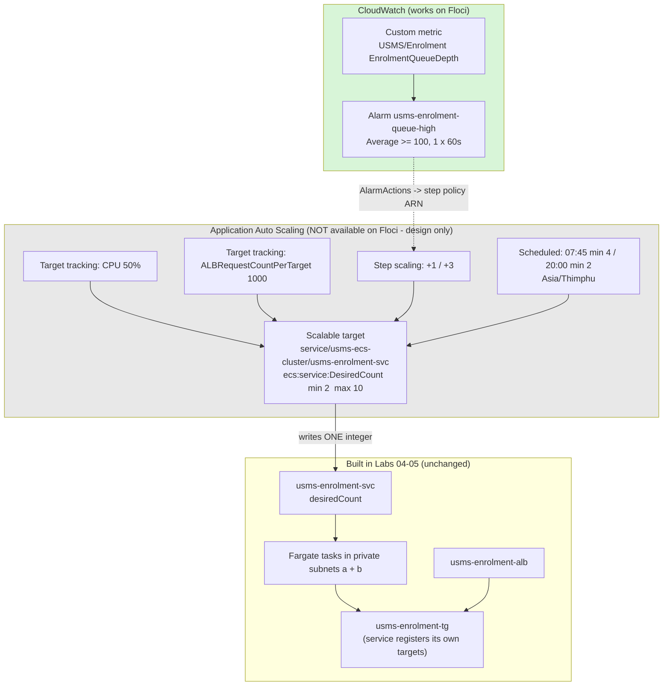

# AWS Practical Laboratory Report

**Name:** Namgyel Wangchuk
**Student No.:** 02230291
**Module:** DSO303
**Practical:** Lab 06 – Implementing Auto Scaling for an ECS-Based Application
**Date:** 11 October 2026

**Tools used:** Floci (local AWS emulator) running under Docker Compose in hybrid storage mode, AWS CLI v1, jq, python3, git, nano

**Floci support path: C – no Application Auto Scaling.** Every `aws application-autoscaling` call returns `UnknownOperationException`. Following the lab's Path C instructions, I informed my instructor and did everything that does not need that API: the CloudWatch custom metric and alarm, all the scaling policy templates, the resource ID, the persistence test, the verify and cleanup scripts, Exercises 3–5, Exercises 1–2 as templates and written answers, and the review questions.

---

## 1. Aim / Objective

The aim of this practical is to make the USMS enrolment service elastic, so that something other than a person changes its `desiredCount`. The plan was to register the ECS service as a scalable target (min 2, max 10) in Application Auto Scaling, add two target tracking policies (CPU and requests per target), a step scaling policy driven by my own CloudWatch alarm on a custom queue-depth metric, two scheduled actions for weekday mornings and evenings, and to practise suspending and resuming scaling. Because my Floci build does not implement Application Auto Scaling, the practical objective became: build and prove every part that the emulator supports, prepare the complete scaling design as valid templates, and explain exactly what real AWS would do for the parts that could not run.

## 2. Introduction

Application Auto Scaling is the AWS service that automatically changes the capacity of resources in other services, such as the number of tasks in an ECS service, DynamoDB throughput or Lambda concurrency. For ECS it does exactly one thing: it reads a metric through a CloudWatch alarm, decides how many tasks there should be, and writes that number into the service's `desiredCount`. Everything after that (starting tasks, registering them with the load balancer, health checks) is done by ECS and the load balancer built in Labs 04 and 05. Auto scaling is important in cloud computing because it lets a system handle busy periods without paying for that capacity all the time, and it is used for web APIs, background workers and anything with traffic that goes up and down.

### Key Features

- **Scalable target:** a registration of one resource's dimension (`ecs:service:DesiredCount`) with a floor and a ceiling
- **Target tracking scaling:** "keep this metric near this number"; AWS creates two CloudWatch alarms for it automatically
- **Step scaling:** "when this alarm fires, add this many tasks, and more if it's worse"; you write the alarm
- **Scheduled scaling:** changes the floor and ceiling at set times, so capacity is ready *before* a known spike
- **Cooldowns:** stop a policy acting twice for one event (scale-out 60 s, scale-in 300 s in this lab)
- **Suspend/resume:** three separate switches to pause scale-in, scale-out or scheduled scaling without deleting anything
- **Service-linked role:** an AWS-owned role that lets Application Auto Scaling call `ecs:UpdateService`

## 3. Use Case

USMS enrolment traffic is very uneven. Most of the year it is quiet, but when enrolment opens, thousands of students register in the first few minutes. Last year the portal fell over 3 minutes after opening.

| Need | Auto scaling feature |
|---|---|
| Never drop below one task per Availability Zone | MinCapacity 2 on the scalable target |
| Don't let a runaway policy run up the bill | MaxCapacity 10 |
| Add tasks when the service gets busy | Target tracking on CPU (50%) and on requests per target (1000/min) |
| React harder when the work queue is badly backed up | Step scaling on a custom metric: +1 task at 100, +3 tasks at 200+ |
| Have capacity ready before 08:00 on weekdays | Scheduled action at 07:45 Asia/Thimphu raising the floor to 4 |
| Freeze scaling during an incident without losing the setup | Suspend scale-in, keep scale-out working |

## 4. System Architecture / Design

The diagram shows the full design. The part this lab adds is the Application Auto Scaling box, which only writes one integer. On my Floci build only the CloudWatch part (green) exists; the Application Auto Scaling part (grey) is the design that would run on real AWS.

*Lab 06 design: the control loop over desiredCount. Green works on my Floci build; grey is the design for real AWS.*

*Image Source: N/A*

## 5. Implementation Procedure

I started Floci, loaded the six env files and confirmed that Labs 02–05 were unchanged and the service was at its baseline of 2 tasks. The support probe showed that Application Auto Scaling is not implemented (`UnknownOperationException`), the same result as in Lab 04, so I followed the lab's Path C. I tried to create the service-linked role, which Floci also does not support. I built and validated the scalable target's resource ID from the service ARN, and recorded `register-scalable-target` failing. I wrote all four scaling configuration templates (CPU and request target tracking, the step policy, and the suspended state) and validated them, and recorded `put-scaling-policy` failing. Then I did the CloudWatch parts, which do work: I published a custom queue-depth metric and created the alarm that would drive the step policy. I pushed the metric past the threshold, forced the alarm into ALARM, and confirmed that `desiredCount` stayed at 2, while calculating the step real AWS would have taken. I proved the alarm and metric survive a Floci restart, checked that the service itself was untouched by this lab, wrote `configs/lab-06.env`, built the verify and cleanup scripts, and committed. Finally I did the exercises: the policy templates for Exercises 1 and 2, a scaling report tool, a written capacity plan, and the hand-off files for Lab 10.

## 6. Results and Evidence

### 6.1 CLI Output

**Screenshot 1**

Load the six env files

/1.png)

*All values from Labs 04 and 05 loaded; the grace period is None, a Floci limitation from Lab 05*

*Image Source: N/A*

---

**Screenshot 2**

Labs 02–05 still intact, and the service at its baseline

/2.png)

*Lab 02 32/1, Lab 03 33/3, Lab 04 38/1, Lab 05 45/4 – the same known Floci failures as before; the service is at desired 2, running 2, with 1 load balancer*

*Image Source: N/A*

---

**Screenshot 3**

Support probe

/3.png)

*Every Application Auto Scaling call is "not available"; CloudWatch, IAM, ECS and ELBv2 are supported*

*Image Source: N/A*

---

**Screenshot 4**

Confirming Path C

/3check.png)

*describe-scalable-targets returns UnknownOperationException: Unknown operation: AnyScaleFrontendService.DescribeScalableTargets*

*Image Source: N/A*

---

**Screenshot 5**

Service-linked role (Step 4)

/c2.png)

*create-service-linked-role returns UnsupportedOperation and the role does not exist (NoSuchEntity)*

*Image Source: N/A*

---

**Screenshot 6**

Resource ID built from the service ARN (Step 5)

/c3.png)

*service/usms-ecs-cluster/usms-enrolment-svc – 3 segments, first segment "service"; register-scalable-target fails with UnknownOperationException*

*Image Source: N/A*

---

**Screenshot 7**

Scaling policy templates (Steps 7, 9, 10, 13)

/c4.png)

*Four valid JSON templates with no unexpanded variables; the ResourceLabel has 6 segments; put-scaling-policy fails with UnknownOperationException*

*Image Source: N/A*

---

**Screenshot 8**

Custom metric and alarm (Step 10)

/c5.png)

*EnrolmentQueueDepth published in USMS/Enrolment; alarm usms-enrolment-queue-high with Average >= 100 over 1 x 60 s, notBreaching, no actions, state INSUFFICIENT_DATA*

*Image Source: N/A*

---

**Screenshot 9**

Pushing the metric and firing the alarm (Step 12)

/c6_fire.png)

*The metric was pushed to 260 but the alarm stayed INSUFFICIENT_DATA for 6 polls; forced to ALARM with set-alarm-state; desiredCount stayed at 2*

*Image Source: N/A*

---

**Screenshot 10**

What real AWS would have done

/c6_stepcalc.png)

*A breach of 160 selects the +3 step, so desiredCount would have gone from 2 to 5*

*Image Source: N/A*

---

**Screenshot 11**

Persistence after a restart (Step 14)

/c8.png)

*The alarm and metric survived; the first diff failed only because of a hidden VS Code terminal marker; both EC2 instances came back stopped and were started again*

*Image Source: N/A*

---

**Screenshot 12**

What this lab changed about the service (Step 15)

/c9.png)

*Task definition still usms-enrolment:2 and still one load balancer – this lab changed nothing about the service*

*Image Source: N/A*

---

**Screenshot 13**

configs/lab-06.env (Step 16)

/c10.png)

*22 exports, no empty values; the policy ARNs are recorded as not-created*

*Image Source: N/A*

---

**Screenshot 14**

Verify script

/c11-verify.png)

*PASS=23 FAIL=19 – every failure is an Application Auto Scaling check or a known Floci limitation*

*Image Source: N/A*

---

**Screenshot 15**

Cleanup script

/c11-cleanup.png)

*lab-06-cleanup.sh passes bash -n and was not run*

*Image Source: N/A*

---

**Screenshot 16**

Cleanup hint strings (Step 17 part 1)

/c11-hints.png)

*The Lab 04 and 05 cleanup scripts already name lab-06-cleanup.sh, so no repair was needed*

*Image Source: N/A*

---

The exercise screenshots are in [`exercises.md`](exercises.md).

### 6.2 AWS Console Verification

Floci has no AWS Management Console, so console screenshots could not be taken. Every resource was checked with `describe-*` and `list-*` commands (Screenshots 5–13) and with `verify-lab-06.sh` (Screenshot 14). On real AWS the scaling would be checked in the ECS console under the service's "Service auto scaling" tab (scalable target, policies, scheduled actions), and the alarms under CloudWatch → Alarms, where the two `TargetTracking-...` alarms created by AWS would also appear.

## 7. Analysis and Discussion

The lab could not be completed as written, because the whole subject of it, Application Auto Scaling, does not exist on my Floci build. Every call to it (`describe-scalable-targets`, `register-scalable-target`, `put-scaling-policy`) returned `UnknownOperationException`, the same result I recorded in Lab 04 Step 3. The lab plans for this as Path C, so I followed that path rather than trying to fake results.

What did work and was proven:
- The resource ID `service/usms-ecs-cluster/usms-enrolment-svc` was built from the service ARN with `${SVC_ARN##*:}` and validated (3 segments, first is `service`).
- All four scaling templates are valid JSON with no unexpanded variables, and the ResourceLabel from Lab 05 passed its 6-segment check (`app` first, `targetgroup` fourth).
- The custom metric and the queue-depth alarm were created in CloudWatch with the exact settings the design needs.
- `set-alarm-state` could force the alarm into ALARM and back to OK.
- The alarm and metric survived a restart.
- The service was left exactly as Lab 05 left it: still revision 2 with one load balancer, back at desired 2.

Results that did not match the lab, and why:

| What happened on Floci | What real AWS would do |
|---|---|
| Every Application Auto Scaling call: `UnknownOperationException` | Register the target, create the policies and scheduled actions, record scaling activities |
| `create-service-linked-role`: `UnsupportedOperation` | Create `AWSServiceRoleForApplicationAutoScaling_ECSService` at path `/aws-service-role/ecs.application-autoscaling.amazonaws.com/` |
| The alarm stayed `INSUFFICIENT_DATA` after publishing 260 three times | Evaluate every minute and go to ALARM within about 60 s |
| Forced ALARM, but `desiredCount` stayed 2 | Invoke the step policy; breach 160 → +3 → desiredCount 5, with a scaling activity whose Cause names the alarm and the policy |
| No `TargetTracking-...` alarms | Two alarms per target tracking policy (high: 3 × 60 s; low: 15 × 60 s) |
| Container Insights was not saved on the cluster in Lab 04 | `AWS/ECS CPUUtilization` would be published, so the CPU policy would have data |
| `deployments` returns null | One PRIMARY deployment |
| EC2 instances come back `stopped` after every Floci restart (Labs 3, 5, 6) | Instances keep running |

Some verify checks gave misleading results that are worth pointing out. "NO suspension switch was left true" **passed**, but only because `describe-scalable-targets` failed, the output was empty, and `grep -ci true` counted zero. That pass proves nothing. It's the same kind of false pass as "cutover done" in Lab 05.

Two other problems were mine or my environment's, not Floci's:
- The first persistence diff failed, but `cat -A` showed the only difference was an invisible VS Code shell-integration marker (`ESC]633;...`) captured at the start of the pre-restart file. After stripping it, the files were identical.
- I did not run the lab's Step 17 part 1 script, because my Lab 04 and 05 cleanup scripts already named `lab-06-cleanup.sh`. The lab's script replaces every occurrence of `lab-04-cleanup.sh`, which would have broken the correct line "Run BEFORE lab-04-cleanup.sh" in `lab-05-cleanup.sh`.

Following Section 12.1 of the lab, I **observed**: a resource ID derived from an ARN and validated, a ResourceLabel validated at six segments, a step table whose bounds are relative to a threshold (and the step it selects), a custom metric in a namespace I invented, an alarm I configured myself, `set-alarm-state` working, and persistence of the alarm and metric. Everything to do with Application Auto Scaling itself I only **reasoned about**: the scalable target and its re-registration, the managed alarms, a policy firing, a scaling activity and its Cause, cooldowns, scheduled actions firing, suspension, and the service-linked role.

## 8. Reflection

**What I learned.** The biggest thing I learned is how little auto scaling actually does: it only writes one number, `desiredCount`. Everything I built in Labs 04 and 05 (ECS starting tasks, the subnets, the security group, the target group registering targets) reacts to that number by itself, which is why this lab didn't need to change the service at all. I also learned that the delays matter more than the thresholds. When I added up the alarm (180 s), task start (20–60 s) and grace period (60 s), a reactive policy is about 5 minutes late, so for something like enrolment that starts at a known time, scheduled scaling is the right tool, not a lower CPU target.

**Challenges.** The main challenge was that the service this lab is about doesn't exist on my emulator. At first that felt like I couldn't do the lab, but Path C showed me how to separate what I could prove from what I could only design. Building the templates and the custom alarm still made me understand the details, like why step scaling bounds are relative to the threshold, and why `--dimensions` has two different formats in two CloudWatch commands. I also lost time on a persistence diff that failed for a reason that had nothing to do with AWS (a hidden VS Code marker), which taught me to use `cat -A` when two lines look identical.

**Real-world use.** For USMS I would use target tracking on requests per target as the main policy, step scaling only for the queue backlog, and scheduled actions for enrolment week and results night, because those dates are in the calendar. I would keep the floor at 2 for the two Availability Zones and raise the ceiling for enrolment week after a load test, and I'd always pair any suspension with a written reminder to remove it.

**What I want to explore next.** I want to run this lab on real AWS, or a Floci build that supports Application Auto Scaling, to actually see a scaling activity with its Cause string and watch the target tracking alarms appear. I'm also interested in load testing the enrolment service to get real numbers for the targets, and in comparing this with the Kubernetes Horizontal Pod Autoscaler in Lab 07.

## 9. Conclusion

The main objective, a working scaling loop on the enrolment service, could not be achieved on this Floci build, because Application Auto Scaling is not implemented. Following the lab's Path C, the rest was achieved: the scalable target's resource ID was derived and validated, the complete scaling design was written as valid templates, the custom metric and the alarm that would drive the step policy were created and tested, their persistence was proven, and the service was confirmed unchanged. The verify script passed 23 of 42 checks, and every failure is explained by the missing API or a known Floci limitation.

The key concepts I took from this lab are that auto scaling writes one integer and nothing else, the difference between target tracking, step and scheduled scaling, why the floor is a latency decision and not just a cost decision, and why a known spike needs scheduled capacity. The capacity plan in Exercise 4 and the Lab 10 readiness file in Exercise 5 carry this work forward even though the loop itself could not run here.

## 10. Appendix

### Additional Files

- `configs/lab-06.env`
- `templates/lab-06-target-tracking-cpu.json`
- `templates/lab-06-target-tracking-requests.json`
- `templates/lab-06-target-tracking-memory.json` (Exercise 1)
- `templates/lab-06-step-scaling-out.json`
- `templates/lab-06-step-scaling-in.json` (Exercise 2)
- `templates/lab-06-suspended-state.json`
- `scripts/utilities/verify-lab-06.sh`
- `scripts/utilities/usms-scaling-report.sh`
- `scripts/utilities/usms-scaling-history.sh`
- `scripts/cleanup/lab-06-cleanup.sh` (written, not run)
- `labs/lab-06-ecs-autoscaling/exercises.md`
- `labs/lab-06-ecs-autoscaling/lab-06-lab10-readiness.txt`
- `labs/lab-06-ecs-autoscaling/lab-06-scale-latency.txt`
- `notes/lab-06-notes.md`

### Submission Checklist

- [x] Student information completed
- [x] Objectives stated
- [x] Introduction provided
- [x] Real-world use case described
- [x] Tools listed
- [x] System design included
- [x] Implementation documented
- [x] CLI outputs included
- [x] Console verification addressed (Floci has no console, see 6.2)
- [x] Analysis completed
- [x] Reflection completed
- [x] Conclusion written